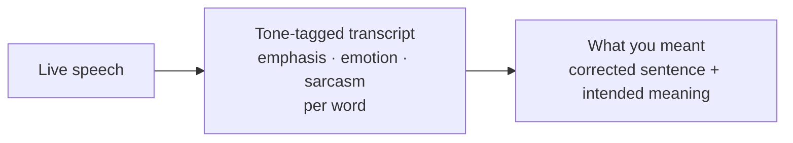
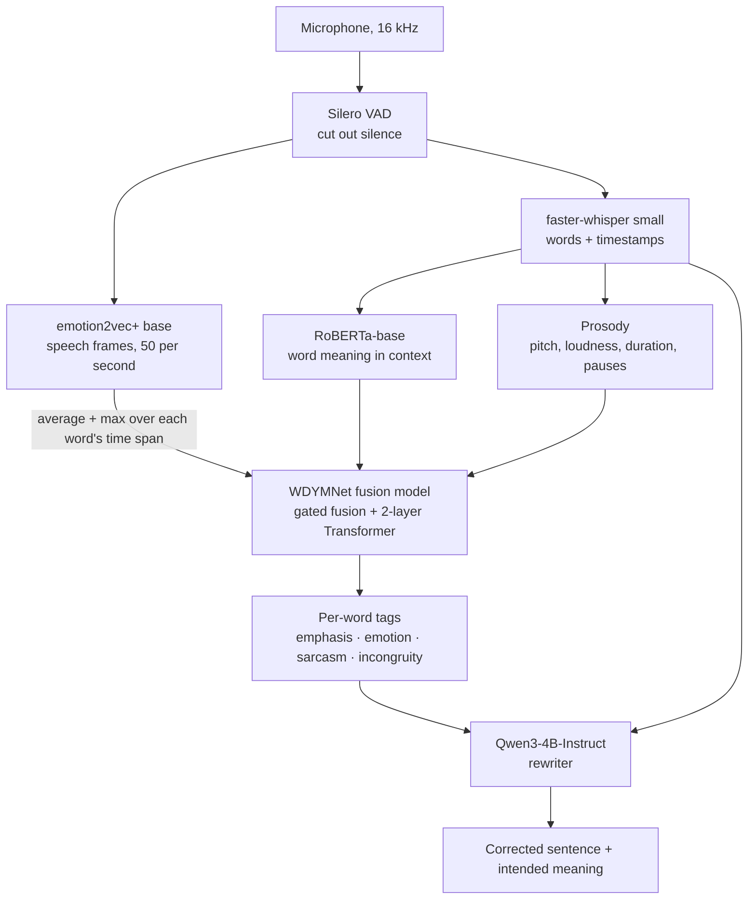
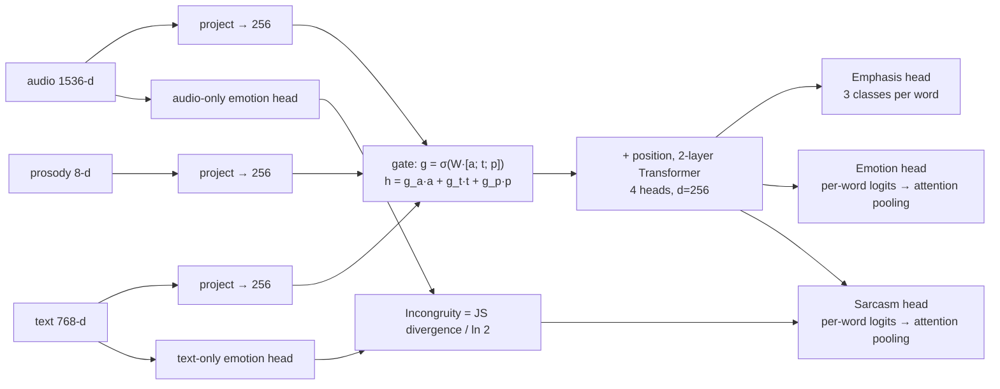
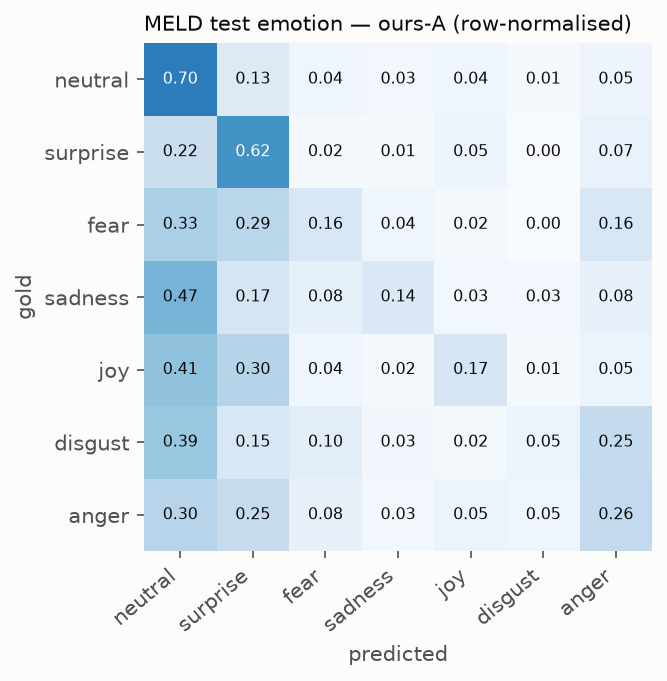
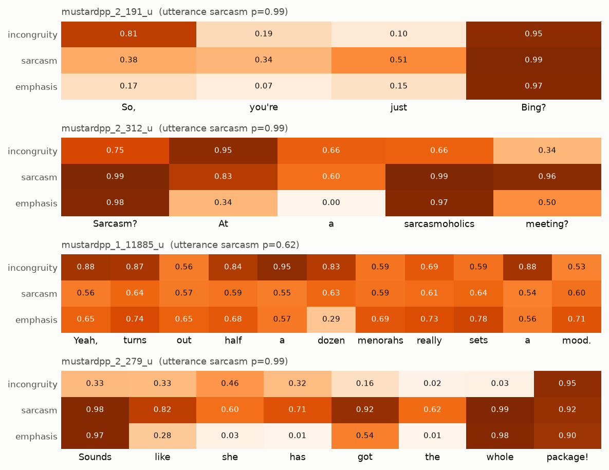
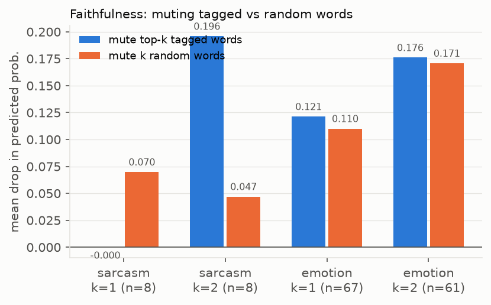
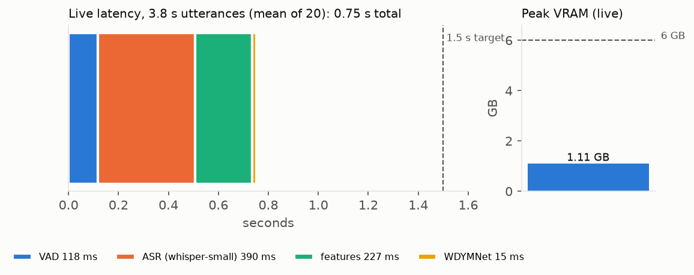

# WDYMNet — *What Do You Mean?*
## Project report: word-level emphasis, emotion and sarcasm detection from speech

*A complete write-up of what was built, why it was built that way, how well it works, and how to run it.
For the short technical reference (commands, hyper-parameters, licences) see the [README](../README.md) and
[DATA_LICENSES.md](../DATA_LICENSES.md).*

---

### Contents
1. [The problem](#1-the-problem)
2. [What the system does](#2-what-the-system-does)
3. [How it works, end to end](#3-how-it-works-end-to-end)
4. [The model in detail](#4-the-model-in-detail)
5. [Data](#5-data)
6. [Training](#6-training)
7. [Results](#7-results)
8. [The live demo](#8-the-live-demo)
9. [The "What you meant" rewriter](#9-the-what-you-meant-rewriter)
10. [Problems we hit and how we fixed them](#10-problems-we-hit-and-how-we-fixed-them)
11. [Limitations — what this does not do](#11-limitations--what-this-does-not-do)
12. [Related work and our contribution](#12-related-work-and-our-contribution)
13. [How to run and reproduce](#13-how-to-run-and-reproduce)
14. [Code map](#14-code-map)
15. [Future work](#15-future-work)
16. [Glossary](#16-glossary)

---

## 1. The problem

Speech-to-text keeps the **words** but throws away **how** they were said. "I *love* waiting in queues" means
the opposite of what the text says when it is said sarcastically, and "*I* didn't take it" means something
different from "I didn't take *it*". Captions, voice assistants, meeting notes and accessibility tools all lose
this information.

Existing research mostly labels a **whole utterance** ("this sentence is angry", "this sentence is sarcastic").
We wanted to know **which words** carry the tone, and to do it **live**, from a laptop microphone, on a consumer
GPU (RTX 4050, 6 GB).

**Goal:** given live speech, produce a transcript where every word is tagged with

| Tag | Values | How it is learned |
|---|---|---|
| **Emphasis** (prominence) | 0 none · 1 prominent · 2 highly prominent | *supervised* — word-level labels exist (Helsinki Prosody Corpus) |
| **Emotion** | 7 MELD classes: neutral, joy, sadness, anger, fear, disgust, surprise | *weakly supervised* — only sentence-level labels exist (MELD) |
| **Sarcasm** | probability | *weakly supervised* — only sentence-level labels exist (MUStARD++) |
| **Incongruity** | 0–1 | *derived* — how much the voice's emotion disagrees with the words' emotion |

…and then turn that into a plain-English statement of **what the speaker meant**.

Example output:

```
I <sarcasm p=.81><emph lvl=2>love</emph></sarcasm> waiting <anger p=.66>in queues</anger>
→ Corrected: "I love waiting in queues!"   Meaning: "They hate waiting in long queues."
```

---

## 2. What the system does



In the demo you speak a sentence (or upload audio). About **0.75 s** later you see the transcript with each word
coloured by emotion, bolded by emphasis and underlined if it carries sarcasm; hovering a word shows all its
probabilities. A few seconds later a second panel shows the **corrected sentence** (speech-recognition errors
fixed, punctuation matching the tone) and **what you meant** (e.g. the real meaning behind sarcasm).

---

## 3. How it works, end to end



1. **Voice activity detection** (Silero VAD) trims silence — it matters because the speech encoder classifies pure
   silence as "surprised".
2. **Speech recognition** (faster-whisper small) gives the words and when each was spoken.
3. Three **feature streams** describe every word:
   * **audio** — what the voice sounds like during that word (emotion2vec+, a speech model pre-trained for
     emotion), averaged and max-pooled over the word's time span;
   * **text** — what the word means in its sentence (RoBERTa);
   * **prosody** — hand-measured pitch (F0), loudness (RMS), duration and pauses, normalised within the sentence.
4. The **WDYMNet fusion model** (ours, 2.6 M parameters) combines the three streams per word and outputs the tags.
5. The **rewriter** (an off-the-shelf language model) reads the transcript plus the tags and writes the corrected
   sentence and its meaning.

Everything runs locally on one 6 GB laptop GPU.

---

## 4. The model in detail



**Gated fusion.** Each word's audio, text and prosody vectors are projected to the same size and mixed with
learned gates, so the model can decide per word how much to trust each stream (e.g. lean on the voice when the
words are neutral).

**Transformer.** A small 2-layer Transformer lets each word see its neighbours — emphasis and sarcasm depend on
context ("*I* didn't" vs "I *didn't*").

**Emphasis head (supervised).** A per-word classifier trained directly on word-level prominence labels.

**Emotion and sarcasm heads — multiple-instance learning (MIL).** We only know the label of the whole sentence,
not of each word. Each word gets its own emotion/sarcasm scores, and an **attention** layer decides how much each
word contributes to the sentence's score:

```
utterance score = Σ attentionᵢ × word scoreᵢ        (attention sums to 1)
```

Training only checks the utterance score, but to get it right the model must put attention on the words that
actually carry the emotion or sarcasm. A small **sparsity** penalty (entropy of the attention) pushes it to focus
on a few words. At inference, the per-word scores and attention are the word-level tags.

**Incongruity — our interpretable sarcasm signal.** Two small extra heads predict emotion per word from the
**audio alone** and from the **text alone**. Incongruity is the Jensen–Shannon divergence between the two
distributions, divided by ln 2 so it lies in [0, 1]:

* 0 → the voice and the words agree;
* 1 → they completely disagree (e.g. happy words, contemptuous voice).

It is shown to the user ("words: joy · voice: anger") and fed into the sarcasm head. The ablation in §7 shows it
is the single most useful input for sarcasm.

**Loss.**
`CE_emphasis + CE_emotion (class-weighted) + CE_sarcasm + 0.3 × (CE_text-only + CE_audio-only) + 0.01 × sparsity`

**Modality dropout.** During training the whole text stream (p = 0.3) or audio stream (p = 0.3) is randomly
zeroed — never both — so the model cannot rely on one modality and still works when, e.g., the transcript is wrong.

---

## 5. Data

All public datasets; no audio is redistributed (see [DATA_LICENSES.md](../DATA_LICENSES.md)).

| Dataset | What it gives us | Size used (train / val / test, after alignment) | Notes |
|---|---|---|---|
| **MELD** (Friends TV series) | sentence-level emotion, 7 classes | 8,845 / 946 / 2,264 utterances | Official splits. Audio from a 1.5 GB audio-only mirror instead of the 10.9 GB video archive. |
| **MUStARD++** (sitcoms) | sentence-level sarcasm, 50 % sarcastic | 825 / 170 / 169 utterances | No official split → we split **by speaker**, so test speakers are never seen in training. |
| **Helsinki Prosody Corpus** + **LibriTTS** (audiobooks) | word-level emphasis 0/1/2 | 4,890 / 832 / 4,817 sentences (≈ 87k / 12k / 90k words) | We train on HPC *dev* (≈ 87k words) to save time, test on HPC *test*. |

**Word timing.** The datasets give the transcript but not when each word was spoken. We force-align the
transcript to the audio with torchaudio's MMS aligner (fallback: Whisper timestamps). MELD clips often contain
other people talking or laughter; clips whose alignment is too unreliable (score < 0.1) are dropped — about 11 %
of MELD, which is why the MELD test set has 2,264 rather than 2,610 clips.

**Caching.** Because the speech and text encoders are frozen for Stage A, their outputs are computed once
(≈ 1.5 h) and cached, which makes training the fusion model take minutes.

---

## 6. Training

The project follows staged milestones (S0–S8), each with its own script:

| Stage | What happens | Time / GPU memory |
|---|---|---|
| S0 | environment check: GPU, ffmpeg, load every model | — |
| S1 | download and prepare the three datasets, build manifests and splits | ≈ 4 GB of downloads |
| S2 | forced alignment + cache all features (resume-safe) | ≈ 1.5 h, 2.5 GB |
| S3 | **Stage A**: train the fusion model on cached features; train baselines B1, B2 | 8 min, 0.2 GB |
| S4 | live demo | 0.75 s per utterance |
| S5 | **Stage B**: fine-tune the top 3 of emotion2vec's 8 blocks + LoRA on RoBERTa | 37 min, 4.7 GB |
| S6 | evaluation: test metrics, ablations, conflict test, faithfulness test, latency | ≈ 30 min |
| S8 | tables and figures for the write-up | seconds |

**Stage A (frozen encoders).** Only the 2.6 M-parameter fusion model trains. AdamW (lr 1e-3), batch 32, up to
15 epochs with cosine schedule; each batch comes from one dataset in turn (MELD → MUStARD++ → HPC), and heads
without labels for that dataset are skipped. MUStARD++ is repeated 4× per epoch because it is ~10× smaller than
MELD. Model selection uses the validation average of emphasis macro-F1, emotion macro-F1 and sarcasm AUC.

**Stage B (partial fine-tuning).** The top 3 transformer blocks of emotion2vec (21 M parameters) and LoRA adapters
on RoBERTa (0.3 M parameters) are trained together with the fusion model, starting from Stage A, with 16-bit
precision and gradient accumulation to fit in 6 GB. Rule: Stage B is only used if it beats Stage A on validation.

**Baselines (for the sanity table).**
* **B0** — emotion2vec+'s own emotion classifier, mapped to MELD labels, no training (the "pretrained-only" model).
* **B1** — utterance-only fusion: average all word features, classify the sentence (no word tags).
* **B2** — Emo-FiLM-style word tagger: copy the sentence label to every word, train an audio-only word classifier.

---

## 7. Results

These are **sanity checks** on standard test sets, not a leaderboard comparison. All numbers are produced by
`scripts/s6_evaluate.py` and stored in `results/`.

### Main table

| Model | Emphasis acc 3-way | Emphasis acc 2-way | Emphasis F1 3-way | Emotion weighted-F1 (MELD) | Sarcasm macro-F1 | Sarcasm AUC |
|---|---|---|---|---|---|---|
| B0 emotion2vec+ zero-shot | – | – | – | 46.2 | – | – |
| B1 utterance fusion | – | – | – | **49.3** | 57.0 | 63.3 |
| B2 Emo-FiLM-style tagger | – | – | – | 43.7 | – | – |
| **Ours, Stage A (used in the demo)** | **72.1** | **84.3** | **69.0** | 46.7 | 56.6 | 65.3 |
| Ours, Stage B (fine-tuned) | 71.2 | 83.1 | 67.5 | 46.7 | **60.8** | **68.5** |

For reference, the HPC authors' text-only BERT, trained on the ~4× larger train-360 set, reports 68.6 % (3-way) /
83.2 % (2-way) accuracy on the same HPC test set; we reach 72.1 / 84.3 with less training data because we also use
the audio (our test set excludes 5 of 4,822 sentences that failed alignment).

### Ablations — which parts matter

| Variant (Stage A retrained without…) | Emphasis acc 3-way | Emotion wF1 | Sarcasm AUC |
|---|---|---|---|
| full model | 72.1 | 46.7 | 65.3 |
| − prosody features | 59.9 (**−12.2**) | 43.8 | 64.8 |
| − incongruity feature | 64.1 | 45.0 | 54.3 (**−11.0**) |
| − modality dropout | 64.8 | 46.1 | 64.7 |

* **Prosody** (pitch, loudness, duration) is what makes emphasis work.
* **Incongruity** is what makes sarcasm work — without it sarcasm detection is near chance.
* **Modality dropout** helps emphasis noticeably.

### What the numbers say

* **Emphasis is the strongest result.** Over 84 % of words are correctly judged prominent / not prominent.
* **Emotion is roughly at baseline level.** Our word-level model matches the pretrained emotion2vec classifier
  (46.7 vs 46.2) and is slightly below the sentence-only baseline B1 (49.3): giving per-word tags costs a little
  sentence-level accuracy. MELD is a notoriously hard dataset (TV audio, laugh tracks, short utterances).
* **Sarcasm is hard.** AUC 0.65 (Stage A) / 0.69 (Stage B) on speakers never seen in training, without
  conversation context, from only 825 training sentences.
* **Fine-tuning (Stage B)** improved sarcasm on test but not emphasis or emotion, and did not beat Stage A on the
  validation set, so the demo uses Stage A.
* **Conflict test** — on sarcastic test clips, the share detected as sarcastic using text only / audio only /
  both: 63 % / 70 % / 63 %. The voice carries more of the sarcasm than the words, and fusion does not yet beat the
  best single modality.

### Are the word tags meaningful? (faithfulness test)

If the model's tagged words really carry the emotion, then silencing those words in the audio should hurt the
prediction more than silencing random words.

| | silence top-1 tagged word | silence 1 random word | silence top-2 tagged | silence 2 random |
|---|---|---|---|---|
| emotion (67 / 61 clips) | 0.121 | 0.110 | 0.176 | 0.171 |
| sarcasm (8 clips) | 0.000 | 0.070 | **0.196** | 0.047 |

*(mean drop in the predicted probability)*

Honest reading: **emotion word tags are not yet more faithful than random words** — the model spreads its emotion
decision over the whole sentence. Sarcasm tags look faithful for two words, but only 8 test clips passed the strict
sarcasm threshold, which is too few to conclude anything.

### Speed and memory

| | |
|---|---|
| Tagged transcript after you stop speaking | **0.75 s** for a 3.8 s utterance (VAD 118 ms · ASR 390 ms · features 227 ms · model 15 ms) |
| "What you meant" panel | ≈ 4–5 s later (shown after the tags, does not delay them) |
| GPU memory, whole live demo | ≈ 5.3 GB of 6 GB (tagger ≈ 1.1 GB + rewriter ≈ 2.7 GB + display) |

### Figures (in `paper_artifacts/`)

| | |
|---|---|
|  |  |
|  |  |

The LaTeX table is in `paper_artifacts/main_table.tex`; the architecture diagram source in
`paper_artifacts/architecture.mmd`.

---

## 8. The live demo

Start: `.venv\Scripts\python -m wdymnet.live.app` → open http://127.0.0.1:7860

* **Push to talk** — record with the microphone button (or upload an audio file); tagging starts when you stop.
* **Continuous** — "Start listening" uses the default microphone and tags each phrase after a pause.
* **Reading the transcript**
  * colour = emotion of that word (legend at the top); uncoloured = neutral;
  * **bold** = emphasised (heavier = more emphasis);
  * dotted underline = sarcasm, only on the 1–2 words the model relied on;
  * hover a word: emphasis, sarcasm and mismatch bars, top emotions, and "words: X · voice: Y".
* Under the line: the sentence's overall emotion, whether it is sarcastic (with probability), and latency.
* **What you meant** panel: the corrected sentence and its intended meaning.

**Display rules (to avoid false alarms).**
* A word is coloured only if its emotion beats its own "neutral" score and a threshold tuned on validation data.
* Sarcasm uses a strict threshold (0.981), calibrated so that at most 10 % of ordinary non-sarcastic speech is
  flagged — because real conversation is not 50 % sarcastic like the training set. The trade-off: it catches about
  15 % of sarcastic sentences. When the demo marks sarcasm it is a hint, not a verdict.

**Tips for showing it live:** speak clearly, one sentence at a time; exaggerate tone for sarcasm; a quiet room
helps (the training audio was TV/audiobook audio, not laptop microphones).

---

## 9. The "What you meant" rewriter

Speech recognition often produces sentences that are grammatical but wrong — "I went for a walk *tomorrow*",
"the *whether* is nice". The rewriter fixes these and explains the intended meaning using the tone tags.

**How.** An off-the-shelf instruction-tuned language model — **Qwen3-4B-Instruct-2507**, in a 4-bit (AWQ) build,
used as-is (not fine-tuned) — receives:

* the transcript;
* plain-language voice cues taken from the same tags the user sees: overall tone and its strength, sarcasm and the
  words it sits on, up to 4 strongly emphasised words, confident word-level emotions, and words the speech
  recogniser was unsure about.

It is prompted to answer in three lines — first listing the words that make no sense (this "think first" step
matters for a small model), then the corrected sentence, then the meaning:

```
Problems:  tomorrow -> today (past tense "went")
Corrected: I went for a walk today and I walked 6 kilometers. It was a very tiring walk.
Meaning:   They completed a 6-kilometer walk and found it physically demanding.
```

**Choosing the model.** We tested on 10 hand-written transcripts with typical grammatical-but-wrong errors
(sound-alikes, time/tense contradictions) plus 2 correct sentences that must stay unchanged
(`scripts/check_rewriter.py`):

| Model | Fixed | Time per sentence |
|---|---|---|
| Qwen2.5-1.5B-Instruct | 4 / 10 | ≈ 1.5 s |
| Qwen3-1.7B | 4 / 10 | ≈ 1.7 s (16 s with "thinking" mode, still 4 / 10) |
| **Qwen3-4B-Instruct-2507 (4-bit)** | **9 / 10** | ≈ 4–5 s |

Only the 4B model reliably notices contradictions, so it is the default. It runs on **CTranslate2** (the same
fast inference engine faster-whisper uses), which is ~3× faster than plain `transformers` generation. The 4-bit
checkpoint is converted once by `wdymnet/ct2_awq.py`, a small converter we wrote because the standard route needs
a package that has no Windows build.

**Caveat.** The rewriter inherits the tagger's mistakes — a missed sarcasm cue gives a literal meaning, a false one
gives an ironic reading. It is a demo feature that has only been spot-checked, not a measured result.

---

## 10. Problems we hit and how we fixed them

These are worth knowing: several changed the results substantially.

| Problem | Symptom | Cause | Fix |
|---|---|---|---|
| Sarcasm everywhere in the demo | Almost every sentence underlined, even genuine praise | (1) MUStARD++ got only ~6 % of training batches, so the sarcasm head never really trained; (2) a 0.5 threshold on a 50/50 training set | Oversample MUStARD++ 4×; calibrate the threshold for ≤ 10 % false alarms; only mark the top 1–2 attended words |
| Training silently blew up | NaN weights after ~5 epochs in some runs | The attention-sparsity loss divided by log(1) = 0 for one-word sentences ("What?") → huge gradients | Compute entropy over real words only; one-word sentences contribute 0 |
| Still unstable | NaN in 16-bit training even after the fix | fp16 / bf16 overflow inside the small fusion model | Stage A trains in full 32-bit precision (cheap at 2.6 M parameters); Stage B keeps fp16 with a gradient scaler. This alone raised emphasis accuracy from 68 % to 72 % |
| Out-of-memory in caching / evaluation | GPU memory spilled over 6 GB | A few MELD clips are minutes long; attention memory grows with length² | Skip clips > 30 s; process long clips in smaller sub-batches |
| Emotion colours on neutral sentences | Words coloured "joy" at 0.38 while "neutral" was 0.52 | Display rule ignored the word's own neutral score | Colour only if the emotion beats neutral and the threshold |
| Rewriter left nonsense in place | "I went for a walk tomorrow" unchanged | 1.5B model too weak; prompt said "keep the speaker's words" | Problems-first prompt + Qwen3-4B (4-bit) |
| Large/slow downloads | MELD video archive 10.9 GB; Google Drive folder limited to 50 files; slow OpenSLR server | — | Audio-only MELD mirror (1.5 GB); per-file Drive download; EU OpenSLR mirror |

---

## 11. Limitations — what this does not do

* **Domain gap.** Training audio is sitcom TV (laugh tracks, overlapping voices) and audiobooks; a laptop microphone
  in a room sounds different, so live accuracy is lower than the test numbers.
* **Weak word labels.** There is no dataset with per-word emotion or sarcasm labels; word tags are inferred from
  sentence labels, and the faithfulness test shows emotion word tags are not yet reliable.
* **Automatic emphasis labels.** The Helsinki Prosody Corpus labels come from an automatic acoustic tool, not human
  listeners.
* **Sarcasm is hard without context.** 825 training sentences from a few speakers, no preceding conversation; the
  strict threshold means most sarcasm is not flagged.
* **English only**, single speaker at a time.
* **The rewriter is not formally evaluated** and can be wrong when the tags are wrong.

---

## 12. Related work and our contribution

Prior work we build on (not ours):

* **ConAttSD** (Zhang et al., 2021) — text-vs-audio incongruity for sentence-level sarcasm detection.
* **Emo-FiLM** (2025) — word-level emotion from emotion2vec frames with sentence pseudo-labels (our baseline B2).
* **Text + speech fusion for speech emotion diarization** (Interspeech 2025).
* **ProSarc** (2026) — audio-only sarcasm onset localisation.
* **Helsinki Prosody Corpus** (Talman et al., 2019) — prominence prediction from text.
* **Speech emotion diarization + ZED dataset** (Wang et al., 2023).

**What this project adds:**
1. One word-level model that jointly tags emphasis (supervised) and emotion + sarcasm (weakly supervised via
   multiple-instance learning) from text + audio + prosody.
2. An interpretable per-word **incongruity** score, shown to be the key input for sarcasm (ablation: AUC
   65.3 → 54.3 without it).
3. A live, local demo (0.75 s latency on a 6 GB laptop GPU) that also turns the tags into a corrected sentence and
   its intended meaning.
4. An honest comparison of partial fine-tuning against the frozen and pretrained-only models.

---

## 13. How to run and reproduce

Requirements: Windows 11 or Linux, Python 3.12, NVIDIA GPU with ≥ 6 GB, ffmpeg on PATH.

```powershell
python -m venv .venv
.venv\Scripts\activate
pip install -r requirements.txt

# just the demo: the trained model (results/checkpoints/stage_a_best.pt) is in the repo;
# encoders and the rewriter LLM (~2.7 GB) download on first launch
python -m wdymnet.live.app

# full pipeline from scratch
python scripts/s0_env_check.py
python scripts/s1_prepare_meld.py
python scripts/s1_prepare_mustardpp.py
python scripts/s1_prepare_hpc.py
python scripts/s2_align_and_cache.py      # ~1.5 h
python scripts/s3_train.py                # ~8 min
python scripts/s5_finetune.py             # ~40 min
python scripts/s6_evaluate.py             # ~30 min
python scripts/s8_make_figures.py
python scripts/check_rewriter.py          # rewriter spot-check
python -m pytest                          # 27 tests
```

* Seed 1337 everywhere; all settings in `configs/*.yaml`.
* Every number in `results/` is written by exactly one script.
* Datasets and features live in `data/` (not in git). Of the checkpoints, only the demo model
  `results/checkpoints/stage_a_best.pt` (11 MB) is committed; the others are re-created by S3/S5/S6.

---

## 14. Code map

| Path | What it does |
|---|---|
| `configs/data.yaml` | dataset paths, label maps, alignment and prosody settings |
| `configs/train_a.yaml`, `train_b.yaml` | Stage A / Stage B training settings |
| `configs/live.yaml` | demo settings: ASR, VAD, checkpoints, thresholds, rewriter model |
| `scripts/s1_prepare_*.py` | download and prepare each dataset, build manifests and speaker-grouped splits |
| `scripts/s2_align_and_cache.py` | forced alignment and feature caching |
| `scripts/s3_train.py`, `s5_finetune.py` | Stage A (+ baselines) and Stage B training |
| `scripts/s6_evaluate.py` | test metrics, ablations, conflict, faithfulness, threshold calibration, latency |
| `scripts/s8_make_figures.py` | figures and LaTeX/CSV tables |
| `scripts/check_rewriter.py` | rewriter spot-check |
| `wdymnet/features/speech.py` | emotion2vec wrapper (split into frozen bottom / trainable top), word pooling |
| `wdymnet/features/text.py` | RoBERTa word vectors, optional LoRA |
| `wdymnet/features/prosody.py` | pitch, loudness, duration, pauses per word |
| `wdymnet/align/aligner.py` | MMS forced alignment, Whisper fallback |
| `wdymnet/models/fusion.py` | **the WDYMNet model** (gated fusion, Transformer, heads, incongruity) |
| `wdymnet/models/baselines.py` | baselines B0 mapping, B1, B2 |
| `wdymnet/losses.py` | multi-task loss with MIL sparsity |
| `wdymnet/train.py`, `finetune.py` | training loops, data loading, Stage B feature recomputation |
| `wdymnet/eval/` | metrics and the word-muting faithfulness test |
| `wdymnet/pipeline.py` | live inference: audio → VAD → ASR → features → tags |
| `wdymnet/rewrite.py`, `ct2_awq.py` | "What you meant" rewriter and its model converter |
| `wdymnet/live/` | Gradio app, continuous microphone stream, HTML rendering |
| `tests/test_wdymnet.py` | unit tests (pooling, frame mapping, VAD, JS bounds, muting, LoRA, losses, rendering, rewriter cues) |

---

## 15. Future work

* **Stronger sarcasm**: a linear probe on the text features alone reaches AUC 0.71 vs our 0.65 — a dedicated
  sarcasm head (or conversation context, which MUStARD++ provides) should help.
* **Faithful emotion word tags**: stronger sparsity, or a small amount of per-word annotation for evaluation.
* **Close the domain gap**: fine-tune on clean read/conversational speech with emotion labels, or record a small
  set of laptop-microphone data.
* **Evaluate the rewriter properly** on a labelled set of noisy transcripts and intended meanings.
* **Train emphasis on the full HPC train-360** (≈ 4× more data).
* **Emotion boundaries** within sentences: evaluate on the ZED dataset.

---

## 16. Glossary

| Term | Meaning |
|---|---|
| **ASR** | automatic speech recognition (speech → text) |
| **VAD** | voice activity detection (speech vs silence) |
| **Prosody** | the melody and rhythm of speech: pitch, loudness, duration, pauses |
| **Prominence / emphasis** | how much a word stands out acoustically |
| **MIL** (multiple-instance learning) | learning per-item (word) predictions from labels on groups (sentences) |
| **Attention pooling** | weighted average where the model learns the weights (which words matter) |
| **JS divergence** | a symmetric measure of how different two probability distributions are |
| **Incongruity** | JS divergence between the voice's and the words' emotion, scaled to 0–1 |
| **Ablation** | retraining without one component to measure what it contributes |
| **AUC** | probability that a random positive is scored above a random negative (0.5 = chance, 1 = perfect) |
| **Weighted / macro F1** | F1 averaged over classes, weighted by class size / unweighted |
| **LoRA** | low-rank adapters: fine-tune a large model by training small extra matrices |
| **AWQ** | a 4-bit weight compression method that keeps quality close to full precision |
| **CTranslate2** | a fast inference engine for Transformer models |
| **Forced alignment** | finding when each word of a known transcript is spoken in the audio |
